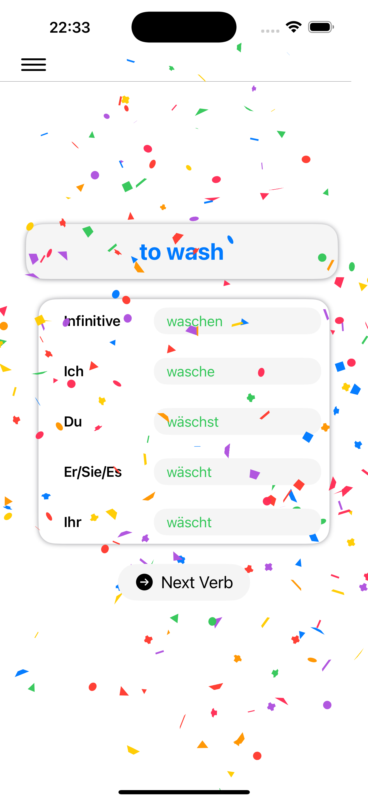
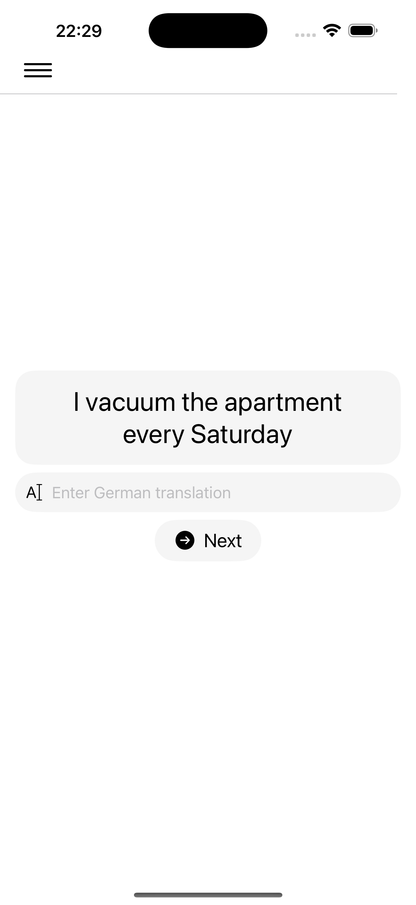
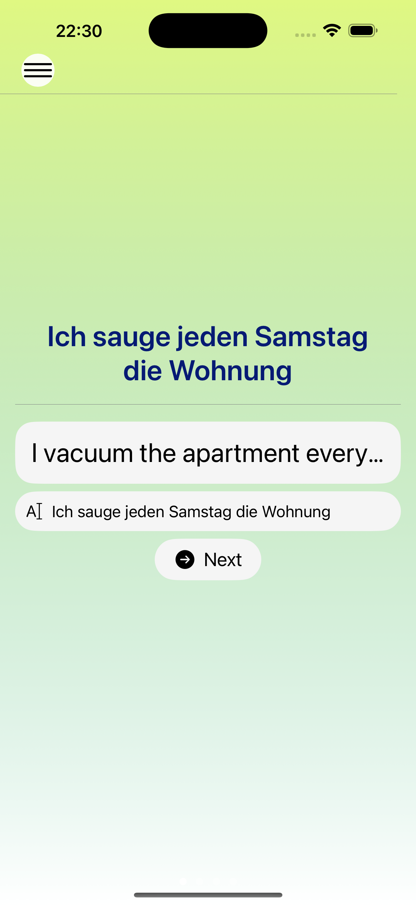
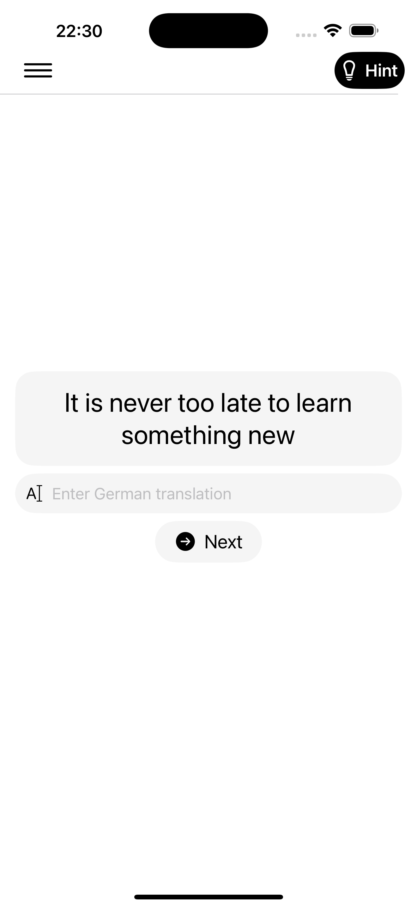
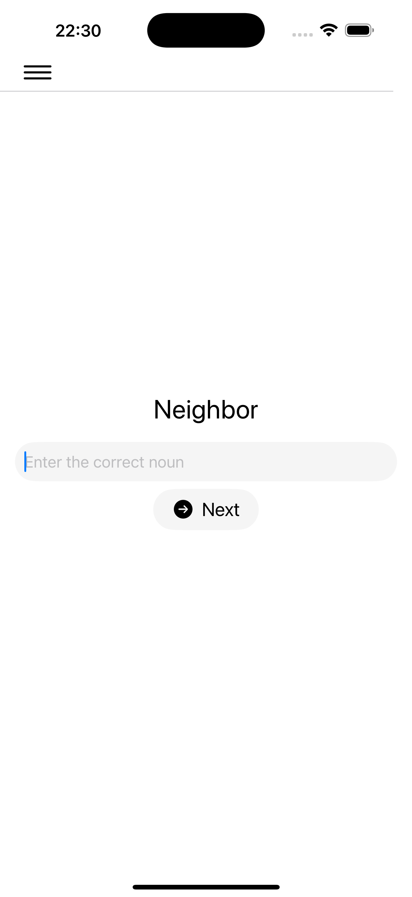
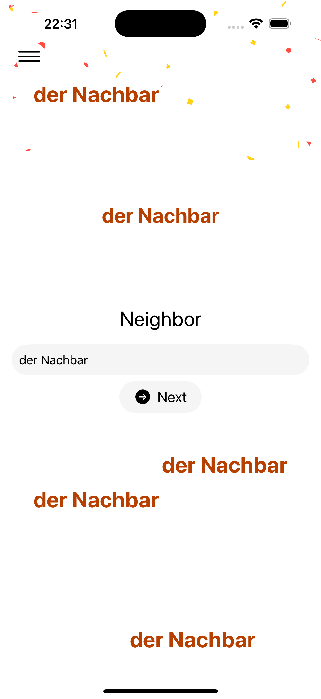
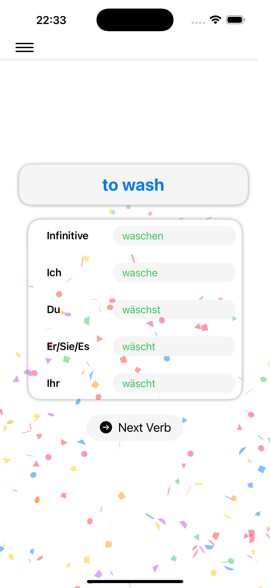
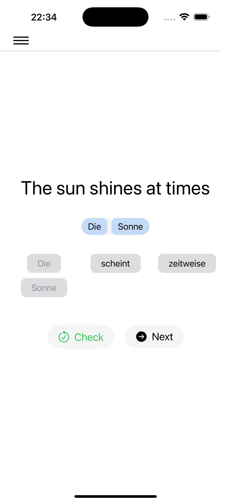
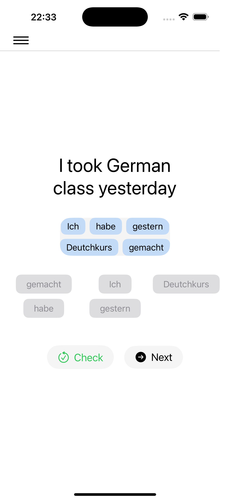

# Weisswein App - Learn German (White Wine) 🍷

A beautiful and educational iOS app for learning German with interactive exercises.

---

## 🚀 Features

- ✍️ Sentence tile assembly game
- 📚 Vocabulary by categories (Nouns, Verbs, Sentences)
- 📤 CSV Import with your own words set

---

## 🖼️ Screenshots

| Screen | Home | Check | Hint |
|------|------|------|------|
| Sentence |  |  |  |
| Noun || ||
| Verb |  |  ||
| Puzzel |||

---

## 🛠 Setup & Run

### 📦 Requirements
- Xcode 15+
- Swift 5.9+
- iOS 16+

